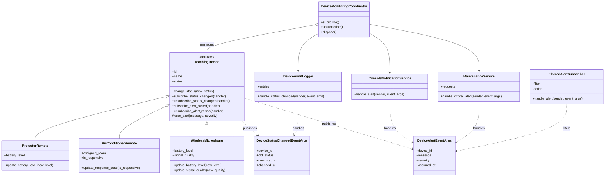

# So do lop - Week 8

## Ghi chu
- Ba loai thiet bi ke thua `TeachingDevice`.
- Publisher khong phu thuoc vao subscriber cu the.
- Coordinator tap trung viec dang ky va huy dang ky handler.
- `FilteredAlertSubscriber` nhan hai callable: ham loc va ham hanh dong.
